# 🌾 AgriCascade (Daryn / Quareo)
### Early Warning System for Food Security & Climate Cascades in Kazakhstan's Grain Belt
> **Система раннего предупреждения продовольственных рисков зернового пояса Казахстана на основе спутниковой радиолокации (Sentinel-2, NASA SMAP), Google Earth Engine, эконометрики и агрономического ИИ-моделирования.**

---

<p align="center">
  
  
  
  
  
  
</p>

---

## 📌 Оглавление
1. [Проблема и научная новизна](#-проблема-и-научная-новизна)
2. [Главный тезис проекта](#-главный-тезис-проекта)
3. [Архитектура системы](#-архитектура-системы)
4. [Аналитические модули](#-аналитические-модули-m1--m7)
5. [Специфика агроклимата Казахстана (Яровые vs Озимые)](#-специфика-агроклимата-казахстана)
6. [Интерактивный дашборд и симулятор](#-интерактивный-дашборд)
7. [Быстрый старт и запуск](#-быстрый-старт)
8. [Структура репозитория](#-структура-репозитория)
9. [Научная база и рецензии](#-научная-база)

---

## 🚨 Проблема и научная новизна

В 2021 году катастрофическая засуха в Казахстане привела к потере миллионов гектаров урожая (сбор упал до 16.4 млн тонн) и взлету цен на хлеб. Однако **Минсельхоз официально объявил ЧС только в середине июля 2021 года**, когда фермеры уже понесли необратимые финансовые потери.

Большинство коммерческих агро-платформ функционируют как **«градусники»** — они лишь констатируют факт усыхания культур постфактум.

**AgriCascade работает как «томограф ранней диагностики»:**
- Мониторит влажность почвы в верховьях трансграничных рек (Тобол в РФ, Или в КНР) за **60–90 дней** до проявления засухи на полях РК.
- Фиксирует аномалии вегетационного сдвига (PhenoShift) за **27–45 дней** до официальных правительственных сводок.
- Математически доказывает влияние индекса вегетации на ценовой спред пшеницы с лагом **3–4 месяца** (тест причинности Грейнджера, $p < 0.05$).

---

## 🎯 Главный тезис проекта

> *«Большинство агро-сервисов — это термометр, фиксирующий уже случившуюся беду. **AgriCascade — это томограф каскадных рисков**. Мы объединили спутниковое зондирование в истоках трансграничных рек с моделью причинности Грейнджера и базой агрономических практик, давая государству и трейдерам **3 месяца форы** для принятия превентивных решений.»*

---

## 🏗️ Архитектура системы

```mermaid
flowchart TD
    subgraph DataSources["🛰️ Спутниковые и открытые источники"]
        S2["Sentinel-2 MSI (10m)<br/>Оптический NDVI"]
        SMAP["NASA SMAP (9km)<br/>Радарная влажность почв"]
        OSM["OpenStreetMap & GEE<br/>Элеваторы и дорожный граф"]
        FAO["FAOSTAT / World Bank<br/>Цены и валовый сбор"]
        GALE["Gale OneFile Agriculture / ICARDA<br/>Научный датасет агропрактик"]
    end

    subgraph Pipeline["⚙️ Вычислительное ядро (ETL & Cloud Engine)"]
        GEE_C["pipeline/gee_client.py<br/>Google Earth Engine API"]
        ECON_C["pipeline/economic_fetcher.py<br/>Экономические ряды"]
    end

    subgraph Modules["🧠 Аналитические модули"]
        M1["M1: PhenoShift (PSI)<br/>Аномалии вегетации"]
        M2["M2: HydroBorder (SMAI)<br/>Трансграничные реки"]
        M3["M3: SiloSentry<br/>Shadow Analytics + Winter Disclaimer"]
        M4["M4: AgriContagion<br/>VAR & Granger Causality (Лаг 3-4 мес.)"]
        M5["M5: MicroVulnerability<br/>Микро-карта уязвимости фермеров"]
        M6["M6: Backtesting 2021<br/>Ретроспективная верификация"]
        M7["M7: Quareo AgroAdvisor<br/>ИИ-дорожная карта защиты урожая"]
    end

    subgraph UI["🖥️ Интерактивный интерфейс (Streamlit)"]
        DASH["dashboard/app.py (localhost:8501)<br/>Bilingual (Қазақша / Русский)"]
        SIM["⚡ Климатический стресс-симулятор"]
        REP["📥 Генерация отчетов (.xlsx / .md / .pptx)"]
    end

    DataSources --> Pipeline
    Pipeline --> Modules
    Modules --> UI
```



---

## 🧠 Аналитические модули (M1 – M7)

### 🌱 M1: PhenoShift — Индекс сдвига вегетации
- **Метрика:** $\text{PSI} = \frac{\text{NDVI}_{\text{cur}} - \mu_{10y}}{\sigma_{10y}}$ (отклонение от 10-летней климатической нормы).
- **Сенсор:** Sentinel-2 MSI (10-метровое пространственное разрешение).
- **Результат:** Индикация засухи за 45–90 дней до уборочной кампании.

### 💧 M2: HydroBorder — Трансграничный гидрологический риск
- **Метрика:** $\text{SMAI}$ (Soil Moisture Anomaly Index).
- **Сенсор:** NASA SMAP (пассивно-активный микроволновой радар L-диапазона).
- **Бассейны:** Реки Тобол (РФ $\to$ Костанай), Или (Китай $\to$ Балхаш), Ишим/Есиль (СКО).

### 🏗️ M3: SiloSentry — Спутниковый мониторинг элеваторов
- **Технология:** Shadow Analytics (оценка заполненности силосных башен по длине внутренних и внешних теней).
- **Логистика:** Построение кратчайших маршрутов переброски зерна в NetworkX/OSMnx.
- **❄️ Shadow Analytics Winter Disclaimer:** Автоматический запрет искаженного оптического расчета в период низкого стояния солнца ($<20^\circ$) и снежного покрова (1 ноября – 31 марта) с переходом в режим фиксации осенней уборки (`DISCLAIMER_WINTER_SHADOW`).

### 📈 M4: AgriContagion — Граф каскадных рисков и эконометрика
- **Математика:** Векторная авторегрессия (VAR) и тест причинности Грейнджера (Granger Causality).
- **Вывод:** Индекс $\text{PSI}$ математически предсказывает скачок локальных цен на пшеницу с лагом **3–4 месяца** ($p < 0.05$).
- **Визуализация:** Sankey-диаграмма каскада («Вода $\to$ Поле $\to$ Элеватор $\to$ Рынок»).

### 🚨 M5: MicroVulnerability — Карта уязвимости хозяйств
- **Формула риска:**
  $$V = 0.40 \cdot |\text{PSI}| + 0.30 \cdot |\text{SMAI}| + 0.20 \cdot D_{\text{элеватор}} + 0.10 \cdot S_{\text{поле}}$$
- **Применение:** Адресное распределение субсидий и страховых выплат для фермеров в красной зоне ($\text{HIGH} \ge 75$).

### 🔙 M6: Backtesting 2021 — Валидация на эталонной засухе
- **Факт:** В 2021 году система зафиксировала критическое падение индекса ($\text{PSI} < -1.5$) **18 июня**, опередив официальное признание засухи Минсельхозом РК на **27 дней**.

### 🌾 M7: Quareo AgroAdvisor — Научно обоснованный датасет
- **Рекомендательный движок:** По культуре, почве и фазе вегетации формирует 3-уровневую дорожную карту:
  1. 🚨 **Экстренные меры (0–48 ч):** антитранспиранты, сухой полив (разрушение корки), подкормка $K_2SO_4$ + аминокислоты.
  2. 📅 **Сезонные меры:** суперабсорбенты SAP, мульчирование соломой, фазовый контроль влаги.
  3. 🏛️ **Стратегические меры:** прямой посев No-Till со стерней 20–30 см, снегозадержание, безотвальное чизелевание на 35–45 см, гипсование.

---

## 🌾 Специфика агроклимата Казахстана

> [!IMPORTANT]
> **Почему мы не считаем вегетацию зимой и в чем роль снегозадержания?**

1. **Доминирование яровых культур на Севере:**
   В Северном Казахстане (СКО, Акмола, Костанай) озимые практически не сеют из-за бесснежных морозов (до $-40^\circ\text{C}$). **Более 95% посевов — это яровая пшеница**, высеваемая в мае и убираемая в августе–сентябре.
2. **Запрет на зимний расчет NDVI:**
   С ноября по апрель поля покрыты снегом. Расчет NDVI зимой давал бы ложный шум.
3. **Решающее значение зимней влаги:**
   Урожай яровой пшеницы на 40–60% предопределяется запасом продуктивной влаги в метровом слое почвы к весеннему севу. Поэтому ключевые зимние практики датасета — **снегозадержание кулисами и снегопахами (`snow_retention_kulisy`)** и **сохранение высокой стерни (`no_till_stubble`)**, аккумулирующие **+50…100 мм продуктивной влаги**.

---

## 🖥️ Интерактивный дашборд

Streamlit-приложение доступно локально на `http://localhost:8501` и включает:
- **Полную двуязычность (🇰🇿 Қазақша / 🇷🇺 Русский)** с переключением в реальном времени.
- **⚡ Stress-Test Simulator:** ползунок моделирования дефицита влаги в реках (от $0\%$ до $-50\%$) с мгновенным пересчетом уязвимости хозяйств и прогноза цен.
- **Экспорт аналитики:** выгрузка полноценных отчетов в Excel (`.xlsx`), Markdown (`.md`) и интерактивной веб-презентации.

---

## 🚀 Быстрый старт

### 1. Клонирование и виртуальное окружение
```bash
git clone https://github.com/Ali-bit-bot-ux/EcoEconomicAnalyzer.git
cd EcoEconomicAnalyzer

python -m venv .venv
# Для Windows:
.venv\Scripts\activate
# Для Linux/macOS:
source .venv/bin/activate
```

### 2. Установка зависимостей
```bash
pip install -r requirements.txt
```

### 3. Настройка переменных окружения
Скопируйте пример конфигурации и укажите сервисный ключ Google Earth Engine:
```bash
cp .env.example .env
```

### 4. Запуск аналитической платформы
```bash
# Запуск интерактивного дашборда:
streamlit run dashboard/app.py

# Или через оркестратор:
python main.py --dashboard
```

---

## 📂 Структура репозитория

```text
daryn/
├── config/
│   └── settings.py               # Координаты бассейнов, полигоны СКО, пороги рисков
├── data/
│   └── processed/                # 12 оптимизированных Parquet-датасетов (PSI, SMAI, цены)
├── dataset/                      # 🌾 Научный датасет Quareo (JSON + CSV)
│   ├── crops.json / .csv         # 16 полевых и зернобобовых культур
│   ├── soils.json / .csv         # 7 ключевых почвенно-климатических зон РК
│   ├── drought_practices.json    # 17 регламентов агротехнологий и водосбережения
│   ├── soil_crop_matrix.json     # Матрица решений «Почва + Растение -> Спасение»
│   └── references.json           # Рецензируемые статьи Gale, FAO, ICARDA
├── modules/
│   ├── m1_phenoshift.py          # Модуль вегетационного сдвига (NDVI)
│   ├── m2_hydroborder.py         # Модуль трансграничной влажности (NASA SMAP)
│   ├── m3_silosentry.py          # Мониторинг элеваторов + Winter Disclaimer
│   ├── m4_agricontagion.py       # Эконометрика: VAR, тест Грейнджера, Sankey
│   └── m5_microvulnerability.py  # Микро-карта уязвимости фермерских полей
├── dashboard/
│   ├── app.py                    # Главный интерактивный дашборд Streamlit
│   └── agroadvisor_tab.py        # Компонент интерактивного агро-советника
├── src/
│   ├── dataset_loader.py         # Валидация и загрузка агрономических данных
│   └── drought_advisor.py        # ИИ-движок формирования дорожных карт
├── presentation/
│   └── index.html                # Интерактивная веб-презентация проекта
├── main.py                       # CLI-оркестратор полного пайплайна
├── requirements.txt              # Зависимости Python
└── README.md                     # Документация проекта
```

---

## 📚 Научная база

Датасет и методология построены на данных мировых и национальных научных центров:
- **Gale OneFile: Agriculture & Gale Academic OneFile** — исследования эффективности суперабсорбентов, осмопротекторов и No-Till в аридных зонах.
- **FAO Land and Water (Irrigation and Drainage Papers No. 56 & 66)** — расчет эвапотранспирации и коэффициентов $K_c$.
- **ICARDA (International Center for Agricultural Research in the Dry Areas)** — технологии снегозадержания и No-Till в Центральной Азии.
- **КазНИИ земледелия и растениеводства (КазНИИЗиР)** — зональные нормативы влагоемкости черноземов и каштановых почв Казахстана.

---

<p align="center">
  <b>AgriCascade (Daryn) &copy; 2026</b><br/>
  <i>Разработано для защиты научно-исследовательских проектов республиканского и международного уровня (Дарын / ISEF).</i>
</p>
