# 🌾 AgriCascade (Daryn / Quareo)
### Early Warning System for Food Security & Climate Cascades in Kazakhstan's Grain Belt
> **Система раннего предупреждения продовольственных рисков зернового пояса Казахстана на основе спутниковой радиолокации (Sentinel-1 SAR, Sentinel-2 MSI, NASA SMAP), Google Earth Engine, эконометрики и агрономического моделирования.**

---

<p align="center">
  
  
  
  
  
  
</p>

---

## 📌 Оглавление
1. [Проблема и научная новизна](#-проблема-и-научная-новизна)
2. [Что умеет платформа](#-что-умеет-платформа)
3. [Архитектура системы](#-архитектура-системы)
4. [Аналитические модули](#-аналитические-модули-m1--m8)
5. [Специфика агроклимата Казахстана](#-специфика-агроклимата-казахстана)
6. [Интерактивный дашборд](#-интерактивный-дашборд)
7. [Быстрый старт и запуск](#-быстрый-старт)
8. [Структура репозитория](#-структура-репозитория)
9. [Данные и проверки](#-данные-и-проверки)
10. [Ограничения и честные формулировки](#-ограничения-и-честные-формулировки)
11. [Научная база](#-научная-база)

---

## 🚨 Проблема и научная новизна

В 2021 году катастрофическая засуха в Казахстане привела к потере миллионов гектаров урожая (сбор упал до 16.4 млн тонн) и взлёту цен на хлеб. Однако **Минсельхоз официально объявил ЧС только в середине июля 2021 года**, когда фермеры уже понесли необратимые финансовые потери.

Традиционный оптический мониторинг (NDVI) слеп перед облачностью, а лист желтеет уже после необратимого повреждения тканей. **AgriCascade** объединяет три независимых контура:

- **Радарный:** Sentinel-1 SAR (VV/VH, RVI/PSI_radar) работает сквозь облака и измеряет свойства поверхности и растительного покрова.
- **Гидрологический:** NASA SMAP даёт влажность поверхностного слоя почвы по 4 регионам и трансграничным бассейнам.
- **Эконометрический:** граф 207 элеваторов и анализ временных рядов связывают полевой стресс с логистикой и ценовой цепочкой.

Платформа охватывает **4 зерносеющих региона** (СКО, Костанай, Акмола, Павлодар), **5 ключевых культур**, **20 районов** и **207 ХПП**. Интерфейс полностью двуязычный: қазақша / русский.

---

## 🎯 Что умеет платформа

| Контур | Что показывает |
|---|---|
| **PhenoMap** | NDVI-аномалия и фенологический сдвиг по региону и культуре |
| **HydroRisk** | Влажность SMAP, SMAI, запас влаги и сценарий водного стресса |
| **SiloGrid** | 207 элеваторов, плечо доставки, дефицит/профицит (реестр и модель, не live-телеметрия) |
| **Contagion** | Граф каскадов и ценовая цепочка; при недостатке наблюдений честно сообщает об ограничении |
| **Vulnerability** | V-Index по 20 реальным районам из реестра |
| **Backtesting 2021** | Ретроспектива на SMAP с baseline строго 2015–2020 |
| **AgroAdvisor** | 7 почв, 16 культур, 17 водосберегающих практик с научной верификацией |
| **Космический сегмент** | Sentinel-1 VV/VH/RVI/PSI_radar, KazEOSat tasking, NOAA Kp/TEC и 3D-куб |

---

## 🏗️ Архитектура системы

```mermaid
flowchart TD
    subgraph DataSources["🛰️ Спутниковые и открытые источники"]
        S1["Sentinel-1 SAR (VV/VH)<br/>Радар сквозь облака"]
        S2["Sentinel-2 MSI<br/>Оптический NDVI"]
        SMAP["NASA SMAP (9 км)<br/>Влажность поверхности"]
        KAZ["KazEOSat-1/2<br/>Паспорта и tasking"]
        OSM["OpenStreetMap<br/>207 элеваторов и дорожный граф"]
        NOAA["NOAA SWPC<br/>Kp-индекс"]
    end

    subgraph Pipeline["⚙️ Вычислительное ядро"]
        GEE_C["pipeline/gee_client.py<br/>Google Earth Engine API"]
        CACHE["modules/space_cache.py<br/>Оффлайн-кэш наблюдений"]
        ECON_C["pipeline/economic_fetcher.py<br/>Экономические ряды"]
    end

    subgraph Modules["🧠 Аналитические модули"]
        M1["M1: PhenoShift<br/>NDVI-аномалия"]
        M2["M2: HydroBorder<br/>SMAI по бассейнам"]
        M3["M3: SiloSentry<br/>207 ХПП"]
        M4["M4: AgriContagion<br/>Граф и ценовая цепочка"]
        M5["M5: MicroVulnerability<br/>20 районов"]
        M6["M6: Backtesting 2021<br/>SMAP, leak-free"]
        M7["M7: Quareo AgroAdvisor<br/>База решений"]
        M8["M8: Космический сегмент<br/>SAR, KazEOSat, TEC"]
    end

    subgraph UI["🖥️ Streamlit"]
        DASH["dashboard/app.py<br/>8 вкладок, KK / RU"]
        SIM["⚡ What-If симулятор"]
        REP["📥 Экспресс-аудит (.md / .xlsx)"]
    end

    DataSources --> Pipeline
    Pipeline --> Modules
    Modules --> UI
```



---

## 🧠 Аналитические модули (M1 – M8)

### 🌱 M1: PhenoShift — сдвиг вегетации
- **Метрика:** $Z = (\text{NDVI}_{cur} - \mu_{10y}) / \sigma_{10y}$ — отклонение от климатической нормы.
- **Сенсор:** Sentinel-2 MSI (10 м для B4/B8).
- **Важно:** в PhenoMap это именно NDVI-аномалия. Радарный `PSI_radar = σ°VH / (σ°VV + σ°VH)` рассчитывается отдельно в космическом сегменте.

### 💧 M2: HydroBorder — трансграничный гидрологический риск
- **Метрика:** SMAI — нормированная аномалия влажности почвы.
- **Сенсор:** NASA SMAP `SPL3SMP_E/006` (9 км).
- **Бассейны:** Тобол (РФ → СКО/Костанай), Ишим/Есиль, Или (КНР → Балхаш), Сырдарья.
- В дашборде доступны 4 реальных региональных ряда SMAP за 2026 год.

### 🏗️ M3: SiloSentry — элеваторы и логистика
- **Реестр:** 207 ХПП: СКО — 52, Костанай — 65, Акмола — 68, Павлодар — 22.
- **Модель:** Haversine-граф + маршрутизация NetworkX, сравнение КТЖ и автотранспорта.
- **Ограничение:** capacity/fill/status — реестр и модель, а не live-телеметрия оператора.

### 📈 M4: AgriContagion — граф каскадных рисков
- **Математика:** VAR, тест Грейнджера и ценовая цепочка «урожай → пшеница → мука → хлеб».
- **Статус:** исторический результат F=6.84 / p=0.012 сохранён как исторический. На текущем коротком ряде (n=8) значимость не воспроизводится — интерфейс показывает ограничение вместо подставных p-value.

### 🚨 M5: MicroVulnerability — карта уязвимости
- **Формула:** $V = 0.40|\text{PSI}| + 0.30|\text{SMAI}| + 0.20 D_{элеватор} + 0.10 S_{поле}$.
- **Данные:** 20 реальных районов из `DISTRICT_REGISTRY`, PSI/SMAI по регионам и расстояния до 207 элеваторов.
- Синтетическая сетка полей удалена из production-пайплайна.

### 🔙 M6: Backtesting 2021 — ретроспективная проверка
- **Метод:** SMAP, baseline строго 2015–2020, декадная норма, порог −1.5.
- **Результат:** по региональным средним сигнал срабатывает за **25–66 дней** до официальной даты; точные даты и упреждение показаны во вкладке.
- **Ограничение:** целевой сценарий «18.06 / SMAI −1.68 / 27 дней» относится к 42 конкретным полям. Их исходная геометрия в репозитории отсутствует, поэтому на региональном среднем он не воспроизводится — это явно указано в UI.

### 🌾 M7: Quareo AgroAdvisor — научно обоснованный датасет
- **Данные:** 7 типов почв, 16 культур, 17 технологий водосбережения, матрица «почва + культура → действие».
- **Дорожная карта:** экстренные меры (0–48 ч), сезонные меры, стратегические меры (No-Till, снегозадержание, чизелевание).
- **Источники:** Gale OneFile, FAO-56, ICARDA, КазНИИЗиР.

### 🛰️ M8: Космический сегмент
- **SAR:** VV/VH в дБ, `PSI_radar = σ°VH/(σ°VV+σ°VH)`, `RVI = 4 × PSI_radar` (dual-pol proxy, диапазон [0,4]).
- **KazEOSat:** паспорта KazEOSat-1/2, WGS84 AOI, локальный JSON Tasking Request, проверка отклонения от надира и предела 35°.
- **Космическая погода:** реальный NOAA Kp, ввод наклонного TEC и B∥, групповая задержка и фарадеевское вращение.
- **3D Space Data Cube:** 693 км → ионосфера → облака → поверхность → модельная корневая зона. Масштаб высот условный.
- **Оффлайн:** наблюдения и NOAA Kp кэшируются; при отсутствии сети вкладка работает на локальном кэше с явной отметкой источника.

---

## 🌾 Специфика агроклимата Казахстана

> [!IMPORTANT]
> **Почему мы не считаем вегетацию зимой и в чём роль снегозадержания?**

1. **Доминирование яровых культур на Севере:**
   В Северном Казахстане (СКО, Акмола, Костанай) озимые практически не сеют из-за бесснежных морозов (до $-40^\circ\text{C}$). **Более 95% посевов — яровая пшеница**, высеваемая в мае и убираемая в августе–сентябре.
2. **Запрет на зимний расчёт NDVI:**
   С ноября по апрель поля покрыты снегом. Расчёт NDVI зимой давал бы ложный шум.
3. **Решающее значение зимней влаги:**
   Урожай яровой пшеницы на 40–60% предопределяется запасом продуктивной влаги в метровом слое к весеннему севу. Поэтому ключевые практики датасета — **снегозадержание кулисами** и **сохранение высокой стерни (No-Till)**, аккумулирующие **+50…100 мм** продуктивной влаги.

---

## 🖥️ Интерактивный дашборд

Streamlit-приложение включает **8 вкладок** и работает на двух языках (🇰🇿 Қазақша / 🇷🇺 Русский):

1. 🌱 **PhenoMap** — NDVI-аномалия и PhenoShift по выбранному региону.
2. 💧 **HydroRisk** — SMAP/SMAI, запас влаги и What-If сценарий.
3. 🏗️ **SiloGrid** — 207 элеваторов и логистика.
4. 📈 **Contagion** — граф каскадов и ценовая цепочка.
5. 🚨 **Vulnerability** — V-Index по 20 районам.
6. 🔙 **Backtesting 2021** — ретроспективная проверка SMAP.
7. 🌾 **AgroAdvisor** — агрономические рекомендации.
8. 🛰️ **Космический сегмент** — SAR, KazEOSat, NOAA Kp/TEC и 3D-куб.

Переключатели региона и культуры пересчитывают карту, метрики, гидрологию и список элеваторов. Ползунок водного стресса динамически меняет дефицит и риск. Экспресс-аудит региона выгружается в `.md`, отчёт — в `.xlsx`.

---

## 🚀 Быстрый старт

### 1. Клонирование и виртуальное окружение
```bash
git clone https://github.com/Ali-bit-bot-ux/EcoEconomicAnalyzer.git
cd EcoEconomicAnalyzer

python -m venv .venv
# Windows:
.venv\Scripts\activate
# Linux/macOS:
source .venv/bin/activate
```

### 2. Установка зависимостей
```bash
pip install -r requirements.txt
```

### 3. Настройка переменных окружения (опционально)
Для живых запросов GEE скопируйте пример и укажите проект:
```bash
cp .env.example .env
# GEE_PROJECT=daryn-505019
```
Без сети дашборд использует локальный кэш `data/processed/space_cache/`.

### 4. Запуск
```bash
streamlit run dashboard/app.py
# или
python main.py --dashboard
```

### 5. Проверка
```bash
python tests/run_all_daryn_tests.py
```

---

## 📂 Структура репозитория

```text
EcoEconomicAnalyzer/
├── config/settings.py                 # Регионы, бассейны, пороги рисков
├── data/processed/                    # Реальные 2026-ряды и производные parquet
│   ├── ndvi_current_2026.parquet
│   ├── hydroborder_regions.parquet
│   ├── vuln_map_regions.parquet
│   ├── backtest_2021_*.parquet
│   └── space_cache/                   # Оффлайн-кэш Sentinel-1 RTC и NOAA Kp
├── dataset/                           # Quareo: 7 почв, 16 культур, 17 практик
├── modules/
│   ├── m1_phenoshift.py
│   ├── m2_hydroborder.py
│   ├── m3_silosentry.py
│   ├── m4_agricontagion.py
│   ├── m5_microvulnerability.py
│   ├── space_segment.py               # SAR, KazEOSat, TEC, 3D
│   ├── space_cache.py                 # Оффлайн-кэш
│   └── executive_audit.py             # Экспресс-аудит региона
├── pipeline/
│   ├── gee_client.py                  # GEE: Sentinel-1/2, SMAP
│   └── economic_fetcher.py
├── dashboard/
│   ├── app.py                         # 8 вкладок и сайдбар
│   ├── agroadvisor_tab.py
│   ├── space_segment_tab.py
│   └── gis_engine.py
├── scripts/                           # Сбор данных и оффлайн-кэша
├── tests/                             # 115 автотестов
├── docs/features/                     # Спецификации фич
├── requirements.txt
└── README.md
```

---

## 📊 Данные и проверки

- **Реальные 2026-ряды:** `ndvi_current_2026` (514 наблюдений), `ndvi_baseline_regions` (2015–2025), `hydroborder_regions` (12 102 строки SMAP), `smap_current_2026` (919 строк).
- **Источники:** GEE `COPERNICUS/S2_SR_HARMONIZED`, `NASA/SMAP/SPL3SMP_E/006`; оффлайн-резерв — Sentinel-1 RTC из Copernicus / Microsoft Planetary Computer (65 acquisition по 4 регионам).
- **Тесты:** `python tests/run_all_daryn_tests.py` — **115/115** (данные, космический сегмент, оффлайн-кэш, двуязычие, регрессия модулей).
- **Сборка:** `python -m py_compile` для затронутых файлов проходит.
- **GEE live:** проект `daryn-505019`; health check `ok`.

---

## ⚠️ Ограничения и честные формулировки

- **Региональный vs полевой масштаб.** SMAP `SPL3SMP_E/006` имеет разрешение 9 км; это региональная оценка, а не измерение конкретного поля. Downscaling до 10 м — отдельная задача и не меняет региональное среднее.
- **42 поля 2021 года.** Исходная геометрия 42 тестовых полей отсутствует в репозитории. Поэтому целевые 18.06 / −1.68 / 27 дней не выдаются за воспроизведённый результат: UI показывает региональный бэктест и явное ограничение.
- **Granger.** Исторический p=0.012 сохранён как исторический результат; на текущем ряде n=8 статистической значимости нет. Synthetic p-values удалены.
- **SAR — не прямое измерение влажности.** VV/VH — обратное рассеяние; RVI — dual-pol proxy, а не полнополяриметрический индекс.
- **Элеваторы.** Заполненность и статус — реестр/модель, не live-телеметрия.
- **KazEOSat.** Tasking Request — локальный черновик; операторский API и телеметрия не подключены.
- **TEC.** Вводится из внешнего измерения; GNSS/IONEX-поток не подключён. Kp сам по себе не пересчитывается в TEC.
- **Economics 2025–2026.** Ряд помечен в UI как прогнозная оценка, а не официальная статистика.

---

## 📚 Научная база

- **Gale OneFile: Agriculture & Gale Academic OneFile** — эффективность суперабсорбентов, осмопротекторов и No-Till в аридных зонах.
- **FAO Land and Water (Irrigation and Drainage Papers No. 56 & 66)** — эвапотранспирация и коэффициенты $K_c$.
- **ICARDA** — снегозадержание и No-Till в Центральной Азии.
- **КазНИИЗиР** — зональные нормативы влагоёмкости чернозёмов и каштановых почв Казахстана.
- **NASA SMAP / GLDAS / IMERG, Copernicus Sentinel-1/2** — спутниковые ряды и метаданные продуктов.

---

<p align="center">
  <b>AgriCascade (Daryn) &copy; 2026</b><br/>
  <i>Разработано для защиты научно-исследовательских проектов республиканского уровня (Дарын).</i>
</p>
